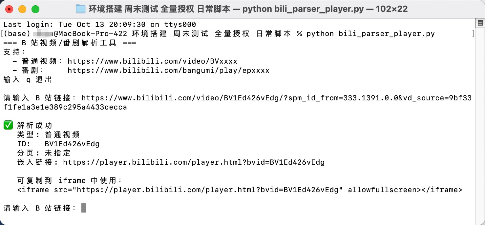

# 1. 脚本展示

```python
import re
from urllib.parse import urlparse, parse_qs, urlencode


def parse_bili(url: str):
    """
    解析 B 站链接：
    - 普通视频：提取 BV 号 + 分页 p
    - 番剧：提取 ep 号 + 分页 p
    返回 (type, id, page) 或 None
    """
    if not url:
        return None

    page = None

    # 补齐协议头
    safe_url = url
    if not safe_url.startswith("http"):
        if safe_url.startswith("//"):
            safe_url = "https:" + safe_url
        else:
            safe_url = "https://" + safe_url

    # 解析 p 参数
    if "." in safe_url and "?" in safe_url:
        parsed = urlparse(safe_url)
        params = parse_qs(parsed.query)
        p = params.get("p", [None])[0]
        if p and p.isdigit():
            page = p

    # 1. 普通视频：bilibili.com/video/BVxxxx
    if "bilibili.com/video/" in url:
        bv_match = re.search(r"BV[0-9A-Za-z]+", url)
        if bv_match:
            return ("video", bv_match.group(0), page)

    # 2. 番剧：bilibili.com/bangumi/play/epxxxx 或 ssxxxx
    if "bilibili.com/bangumi/play/" in url:
        ep_match = re.search(r"ep(\d+)", url)
        if ep_match:
            return ("bangumi_ep", ep_match.group(1), page)
        ss_match = re.search(r"ss(\d+)", url)
        if ss_match:
            return ("bangumi_ss", ss_match.group(1), page)

    return None


def build_embed_url(kind: str, vid: str, page: str = None) -> str:
    """构建 B 站嵌入播放器 URL"""
    base = "https://player.bilibili.com/player.html"
    params = {}

    if kind == "video":
        params["bvid"] = vid
    elif kind == "bangumi_ep":
        params["ep_id"] = vid
    elif kind == "bangumi_ss":
        params["season_id"] = vid

    if page:
        params["p"] = page

    return f"{base}?{urlencode(params)}"


def main():
    print("=== B 站视频/番剧解析工具 ===")
    print("支持：")
    print("  - 普通视频：https://www.bilibili.com/video/BVxxxx")
    print("  - 番剧：    https://www.bilibili.com/bangumi/play/epxxxx")
    print("输入 q 退出\n")

    while True:
        url = input("请输入 B 站链接：").strip()

        if url.lower() in ("q", "quit", "exit"):
            print("已退出。")
            break

        result = parse_bili(url)

        if not result:
            print("❌ 无法识别该链接，请确认是 B 站视频或番剧链接\n")
            continue

        kind, vid, page = result
        embed_url = build_embed_url(kind, vid, page)

        kind_name = {
            "video": "普通视频",
            "bangumi_ep": "番剧（EP）",
            "bangumi_ss": "番剧（SS）",
        }[kind]

        print(f"\n✅ 解析成功")
        print(f"   类型: {kind_name}")
        print(f"   ID:   {vid}")
        print(f"   分页: {page if page else '未指定'}")
        print(f"   嵌入链接: {embed_url}")
        print(f"\n   可复制到 iframe 中使用：")
        print(f'   <iframe src="{embed_url}" allowfullscreen></iframe>\n')


if __name__ == "__main__":
    main()
```

# 2. 脚本执行结果


## 2.1 样例


```yaml
执行 python bili_parser_player.py
输入 https://www.bilibili.com/video/BV1Ed426vEdg/?spm_id_from=333.1391.0.0&vd_source=9bf33f1fe1a3e1e389c295a4433cecca
输出 <iframe src="https://player.bilibili.com/player.html?bvid=BV1Ed426vEdg" allowfullscreen></iframe>
```
## 2.2 结果展示
```yaml
稍加修饰
<iframe width="100%" height="468" src="//player.bilibili.com/player.html?bvid=BV1Ed426vEdg" scrolling="no" border="0" frameborder="no" framespacing="0" allowfullscreen="true"> </iframe>
```
<iframe width="100%" height="468" src="//player.bilibili.com/player.html?bvid=BV1Ed426vEdg" scrolling="no" border="0" frameborder="no" framespacing="0" allowfullscreen="true"> </iframe>
